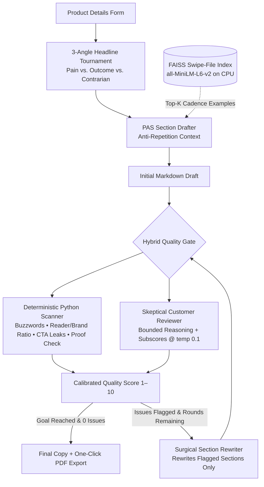

# Market-Copy-LLM — Self-Improving Marketing Copywriter

[](https://colab.research.google.com/github/projectsbyag/MARKET-COPY-LLM/blob/main/Market_Copy_LLM.ipynb)

-09090B.svg)


**Market-Copy-LLM** is an autonomous, self-critiquing copywriting agent engineered to run inside a Google Colab T4 GPU with 15 GB VRAM. Given a product brief, it runs a three-angle headline tournament, drafts conversion copy using **PAS (Problem → Agitate → Solution)** frameworks backed by a FAISS swipe-file index, and iteratively refines weak paragraphs through a **hybrid deterministic + simulated customer review loop**. The winning copy and score trajectory can be exported to a clean monochrome PDF.

---

## Interface & Self-Improvement Trace

### 1. Copywriting Studio UI


### 2. Multi-Round Customer Review & Reasoning Log


---

## System Architecture



## Core workflow

1. **Headline tournament:** generates pain, outcome, and contrarian headline variants, then selects the strongest angle.
2. **PAS drafting:** writes a structured landing page covering the customer problem, agitation, mechanism, proof, and call to action.
3. **Swipe-file retrieval:** uses `all-MiniLM-L6-v2` embeddings and FAISS to retrieve relevant cadence examples without copying their product details.
4. **Hybrid review:** combines deterministic copy scans with a skeptical-buyer LLM critique covering clarity, believability, repetition, flow, hype, and audience focus.
5. **Surgical revision:** rewrites flagged sections while preserving the best-scoring draft and stops early when the quality target is reached.
6. **Export:** generates Markdown, JSON review history, a FAISS index, and a formatted PDF.

## Implementation

- **Language model:** `Qwen/Qwen2.5-7B-Instruct` with 4-bit BitsAndBytes quantization.
- **Embeddings:** `SentenceTransformer("all-MiniLM-L6-v2")` running on CPU to reserve GPU memory for generation.
- **Retrieval:** FAISS `IndexFlatIP` over normalized swipe-file embeddings.
- **Interface:** Gradio form with streamed progress, final copy, review notes, and PDF download.
- **Runtime:** Python notebook designed for Google Colab and CUDA-enabled environments.

## Running the notebook

Open the notebook in Colab using the badge above, then run the cells in order. The notebook installs the required packages automatically, including:

```bash
pip install transformers accelerate bitsandbytes sentence-transformers faiss-cpu pypdf gradio fpdf2
```

A CUDA-enabled GPU is recommended. CPU-only execution may work with a smaller model but will be considerably slower.

## Example brief

The included example uses **LedgerSnap**, a receipt and invoice workflow for freelance developers and solo agency owners. It demonstrates how the system turns a product brief into copy such as:

> Save 4.5 hours/month with LedgerSnap.

The generated result includes a problem-focused hook, cost-of-inaction and mechanism sections, proof-oriented messaging, customer review notes, score progression, and a clear call to action.

## Limitations

- Automated quality scores are heuristics and should not replace real conversion data or user research.
- Generated proof claims must be reviewed before publication.
- The included swipe file is intentionally small and should be expanded with appropriately licensed examples for production use.
- The notebook is a research/demo workflow rather than a production API service.

## Technology

Python · PyTorch · Transformers · BitsAndBytes · Sentence Transformers · FAISS · Gradio · FPDF2 · Google Drive
