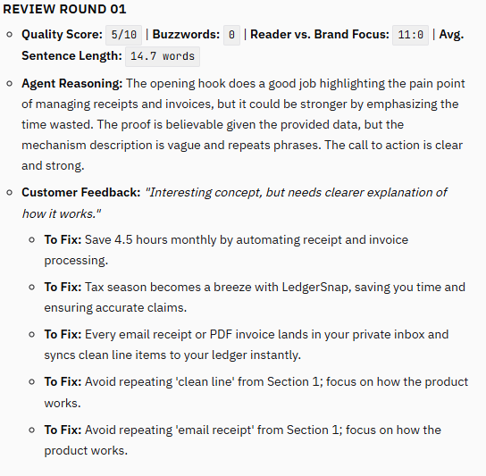
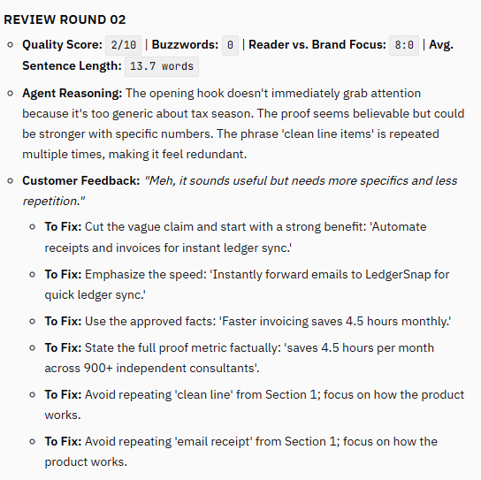
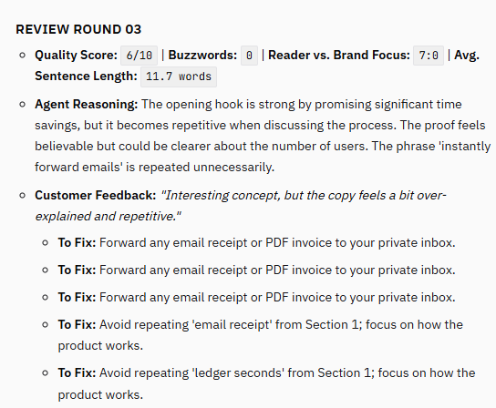
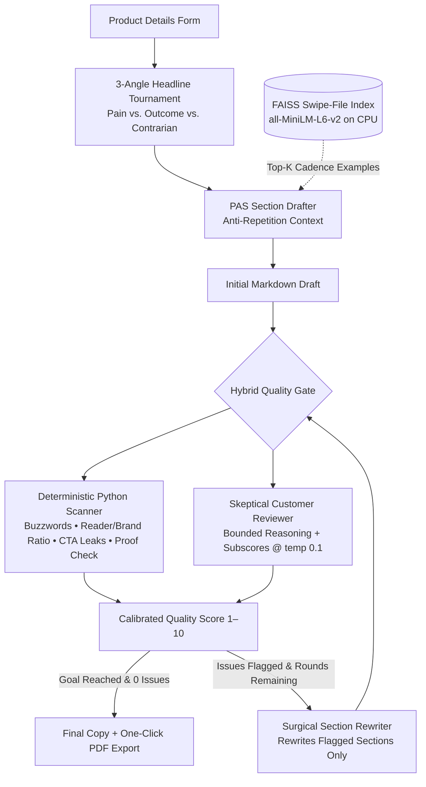

# Market-Copy-LLM — Self-Improving Marketing Copywriter

[](https://colab.research.google.com/github/projectsbyag/MARKET-COPY-LLM/blob/main/Market_Copy_LLM.ipynb)

-09090B.svg)


**Market-Copy-LLM** is an autonomous, self-critiquing copywriting agent engineered to run completely inside a free Google Colab T4 GPU with 15 GB VRAM. Given a product brief, it runs a three-angle headline tournament, drafts conversion copy using **PAS (Problem → Agitate → Solution)** frameworks backed by a FAISS swipe-file index, and iteratively refines weak paragraphs through a **hybrid deterministic + simulated customer review loop**—exporting the winning copy and score trajectory to a clean monochrome PDF.

---

## Interface & Self-Improvement Trace

### 1. Copywriting Studio UI (Monochrome Editorial Interface)


### 2. Multi-Round Customer Review & Reasoning Log

The reviewer exposes a bounded explanation, customer feedback, measurable copy diagnostics, and targeted fixes for each revision round.

#### Review Round 01 — Identifying vague mechanisms and repeated phrases



#### Review Round 02 — Tightening the hook and validating proof



#### Review Round 03 — Checking final clarity and repetition



---

## System Architecture



---

## Key Features & Engineering Decisions

1. **Right-Sized for Free T4 VRAM (`Qwen2.5-7B-Instruct` in 4-bit NF4)**
   - Quantizes `Qwen2.5-7B-Instruct` with BitsAndBytes NF4 and double quantization, leaving GPU memory available for generation and context.
   - Keeps `all-MiniLM-L6-v2` embeddings on CPU to reserve GPU memory for the language model.

2. **Zero-Overhead Bounded Reasoning**
   - The reviewer emits a structured `step_by_step_reasoning` field before scoring.
   - This keeps feedback inspectable without introducing an unrestricted hidden reasoning chain.

3. **Hybrid Deterministic + Simulated Customer Scoring**
   - The agent combines customer-persona roleplay with objective Python scanners for hype words, reader-versus-brand focus, repeated phrases, sentence length, CTA leaks, and proof signals.
   - This reduces grade inflation from relying on an LLM judge alone.

4. **Surgical Section-Level Rewriting**
   - Verified issues are mapped to their parent Markdown section.
   - Only flagged sections are rewritten, so strong copy is preserved across review rounds.

5. **Editorial Monochrome UI & Instant PDF Export**
   - Built with Gradio using an IBM Plex / JetBrains Mono-inspired editorial style, plain-language labels for non-technical users, streamed progress, and an integrated `fpdf2` PDF generator.

---

## Repository Structure

```text
MARKET-COPY-LLM/
├── Market_Copy_LLM.ipynb
├── assets/
│   ├── ui_review_round_01.png
│   ├── ui_review_round_02.png
│   └── ui_review_round_03.png
├── Opera Snapshot_2026-11-12_230651_c2d7bd01ec2d28f50d.gradio.live.png
├── Opera Snapshot_2026-11-12_230826_c2d7bd01ec2d28f50d.gradio.live.png
└── README.md
```

---

## Quickstart (Google Colab)

1. Click the **Open in Colab** badge at the top of this README.
2. Select **Runtime → Change runtime type → T4 GPU**.
3. Run the 10 notebook cells sequentially:
   - **Cells 1–3:** install core ML libraries, load 4-bit `Qwen2.5-7B-Instruct`, and initialize CPU `SentenceTransformer` plus JSON helpers.
   - **Cells 4–6:** build the FAISS swipe-file index, deterministic copy scanner, PAS drafter, headline tournament, and customer reviewer.
   - **Cells 7–8:** run the optional CLI workflow and artifact-saving helpers.
   - **Cells 9–10:** install `gradio` and `fpdf2`, then launch the Self-Improving Marketing Copywriter UI with one-click PDF download.

The notebook installs the required packages automatically, including:

```bash
pip install transformers accelerate bitsandbytes sentence-transformers faiss-cpu pypdf gradio fpdf2
```

A CUDA-enabled GPU is recommended. CPU-only execution may work with a smaller model but will be considerably slower.

---

## Example Brief

The included example uses **LedgerSnap**, a receipt and invoice workflow for freelance developers and solo agency owners. It demonstrates how the system turns a product brief into copy such as:

> Save 4.5 hours/month with LedgerSnap.

The generated result includes a problem-focused hook, cost-of-inaction and mechanism sections, proof-oriented messaging, customer review notes, score progression, and a clear call to action.

---

## Limitations

- Automated quality scores are heuristics and should not replace real conversion data or user research.
- Generated proof claims must be reviewed before publication.
- The included swipe file is intentionally small and should be expanded with appropriately licensed examples for production use.
- The notebook is a research/demo workflow rather than a production API service.

---

## Technology

Python · PyTorch · Transformers · BitsAndBytes · Sentence Transformers · FAISS · Gradio · FPDF2
